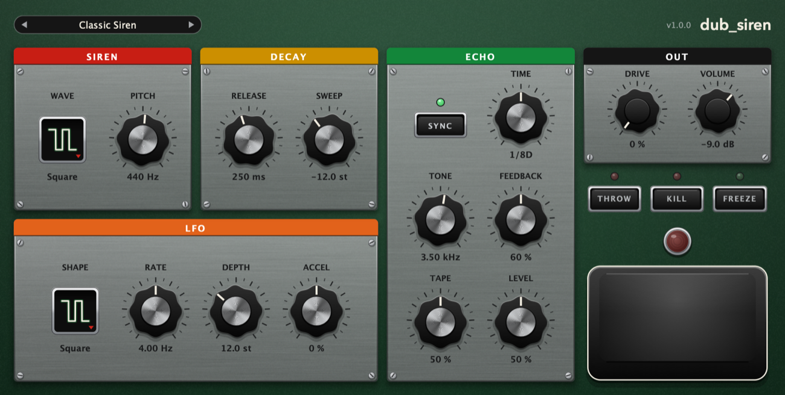

# dub_siren

dub_siren is an instrument plug-in modelled on a classic dub siren pedal: an oscillator swept by an
LFO, a trigger button, a pitch sweep when you let go, and a tape-style echo that can run past 100%
feedback into self-oscillation.



Formats: **VST3** (macOS, Windows, Linux), **AU** (macOS), **LV2** (Linux) and a **standalone app**
on every platform.

## Download and install

Download the zip for your system from the [latest release](https://github.com/tilohk/dub_siren/releases/latest).
The repository is private, so you need to be signed in to GitHub with access to it. Each zip
contains `INSTALL.txt` with the exact steps.

**macOS:** unpack the zip, open Terminal, type `bash ` (with a space), drag `install-macos.sh` from
the unpacked folder into the window and press Enter. It copies the VST3 and the AU into your user
plug-in folders, unblocks them and puts the app into Applications. With the
[GitHub CLI](https://cli.github.com) signed in, the script also works on its own and downloads the
latest release first:

```bash
bash packaging/install-macos.sh
```

Then rescan plug-ins in your DAW. In Ableton Live: **Settings → Plug-Ins**, hold **Option (⌥)** and
click **Rescan**.

By hand:

| System  | Copy | To |
|---|---|---|
| macOS   | `dub_siren.vst3` / `dub_siren.component` | `~/Library/Audio/Plug-Ins/VST3/` / `~/Library/Audio/Plug-Ins/Components/` |
| Windows | `dub_siren.vst3` | `C:\Program Files\Common Files\VST3\` |
| Linux   | `dub_siren.vst3` / `dub_siren.lv2` | `~/.vst3/` / `~/.lv2/` |

You will find it as **dub_siren** by **Tilo Hauk** (category: instrument).

`~/Library` is the Library folder inside your home folder, not the system-wide `/Library`. The macOS
build is not notarised by Apple: after copying by hand, run this once, otherwise macOS blocks the
plug-in and your DAW may hang while scanning:

```bash
xattr -dr com.apple.quarantine ~/Library/Audio/Plug-Ins/VST3/dub_siren.vst3 ~/Library/Audio/Plug-Ins/Components/dub_siren.component
```

**Requirements:** macOS 10.13 or later (Apple silicon and Intel), Windows 10 or later (64-bit),
Linux x86_64 (glibc 2.35 or newer) with ALSA or JACK for the standalone app.

## Controls

**Siren**
- **Wave:** square, saw, triangle or sine.
- **Pitch:** the base pitch. The **TRIGGER** button and MIDI note C3 (note 60) play this pitch;
  other notes transpose it, so you can tap one key like a pedal or play melodies.

**LFO:** bends the pitch upwards from the base tone. It restarts on every press, so tapping the
trigger gives rhythmic patterns.
- **Shape:** square (two-tone), triangle (wail), saw up, saw down (laser zap), sine, S&H (random),
  or **Rotor** (see below).
- **Rate:** speed in Hz.
- **Depth:** how far the pitch moves, up to 36 semitones.
- **Accel:** while you hold the trigger, the LFO speeds up (positive) or slows down (negative), up
  to 1.5 octaves per second: "wee-woo-woo-wowowow". Each press starts again from the Rate setting.

**Rotor mode** models an air-raid siren: a rotor spins up while you hold the trigger, which raises
the pitch towards **Depth**, and coasts down when you let go. It keeps its momentum, so quick taps
give stuttering bursts that climb higher and higher. In this mode **Rate** becomes **Spin-up** (how
fast the rotor gets going) and **Release** sets how long it coasts, so try a long release.

**Decay**
- **Release:** how long the siren keeps sounding after you let go.
- **Sweep:** how far the pitch slides (±48 semitones) during the release.

**Echo**
- **Sync** and **Time:** a note division locked to the tempo (default: dotted 1/8), or free in ms
  with Sync off.
- **Feedback:** up to 120%. Above 100% the echo self-oscillates; saturation keeps it bounded.
- **Tape:** how worn the tape is. Higher values make the delay time follow the Time knob more
  slowly (turning it bends the pitch of the repeats) and add wow and flutter.
- **Tone:** darkens the repeats; it sits inside the feedback loop, so each repeat gets darker.
- **Level:** echo volume.

**Echo performance buttons** (below the trigger)
- **THROW** (hold): mutes the dry siren, so you only hear what goes into the echo. Hold it and tap
  the trigger for classic echo throws.
- **KILL** (hold): stops feeding the echo; the siren keeps playing dry and the tail rings out.
- **FREEZE** (click on, click off): loops what is in the echo right now, at full feedback, and
  ignores new input. Turning **Time** while frozen changes the loop's speed and pitch.

**Out**
- **Drive:** saturation on the whole output, like pushing a mixer channel. It adds grit and
  density while keeping the level about the same.
- **Volume:** output level. A soft limiter catches runaway feedback.

**Triggering:** hold the **TRIGGER** button, play MIDI notes, or automate the **Trigger** parameter
from your DAW. Throw, Kill and Freeze are automatable parameters too.

**Presets:** five factory presets (Classic Siren, Rising Alarm, Laser Zap, Rotor Wind-up, Space
Wobble). Pick one with the arrows or by clicking the display in the top left, or from your DAW's
program list. A preset sets every sound control and leaves Volume alone.

## Build from source

You need CMake 3.22 or later and a C++20 compiler: Xcode 14+ (or the Xcode command line tools) on
macOS, Visual Studio 2022 on Windows, GCC 11+ or Clang 14+ on Linux. JUCE 8 is downloaded
automatically during configuration. On Linux, install JUCE's dependencies first (the list is in
`.github/workflows/build.yml`).

```bash
cmake -S . -B build -G Ninja -DCMAKE_BUILD_TYPE=Release
```

```bash
cmake --build build
```

Without Ninja installed, leave out `-G Ninja` (CMake then uses Makefiles). Building with
`--target DubSiren_All` builds only the plug-ins and the app, not the tests.

The plug-ins end up in `build/DubSiren_artefacts/Release/` and are also copied into your plug-in
folders (on macOS `~/Library/Audio/Plug-Ins/VST3/` and `~/Library/Audio/Plug-Ins/Components/`).
Rescan plug-ins in your DAW afterwards. The standalone app is
`build/DubSiren_artefacts/Release/Standalone/dub_siren.app`.

Options:
- `-DSIREN_JUCE_DIR=/path/to/JUCE` (or the `JUCE_DIR` environment variable) uses a local JUCE
  checkout instead of downloading it.
- `-DSIREN_COPY_PLUGIN=OFF` skips copying into the plug-in folders.
- `"-DCMAKE_OSX_ARCHITECTURES=arm64;x86_64"` builds a universal binary (Apple silicon and Intel).

GitHub Actions builds and tests every push on macOS, Windows and Linux
(`.github/workflows/build.yml`): the DSP tests, [pluginval](https://github.com/Tracktion/pluginval)
at strictness 10 on the VST3 (and the AU on macOS, the LV2 on Linux), and `auval` on macOS.

### Tests

```bash
ctest --test-dir build --output-on-failure
```

`SirenDspTest` runs offline checks of the oscillator, LFO, envelope and echo (no JUCE needed):
pitch accuracy, release behaviour, rotor spin-up and coast, Accel, echo timing, Kill and Freeze, and
that 120% feedback stays bounded.

To validate the built plug-ins:

```bash
auval -v aumu Dbsr Tlhk
```

```bash
/Applications/pluginval.app/Contents/MacOS/pluginval --strictness-level 10 --validate ~/Library/Audio/Plug-Ins/VST3/dub_siren.vst3
```

## Project layout

- `src/dsp/`: the sound engine in plain C++ (`SirenVoice`, `Oscillator`, `Lfo`, `Envelope`,
  `TapeDelay`).
- `src/params/Parameters.h`: every parameter, its range and default.
- `src/params/Presets.h`: the factory presets.
- `src/PluginProcessor.*`: MIDI handling, tempo sync and the signal chain.
- `src/PluginEditor.*`, `src/ui/`: the interface.
- `tests/`: the DSP tests.
- `packaging/`: the macOS installer and the `INSTALL.txt` that goes into every release zip.
- `tools/UiSnapshot.cpp`: renders the interface to PNG files without opening a window. Configure
  with `-DSIREN_BUILD_UI_SNAPSHOT=ON`, build, then run
  `build/SirenUiSnapshot_artefacts/Release/SirenUiSnapshot <output-folder>`.

## Releases

The version lives in one place: `project(DubSiren VERSION ...)` in `CMakeLists.txt`. To release:

1. Set the version in `CMakeLists.txt` and move the changes in `CHANGELOG.md` from **Unreleased**
   to a new section `## [X.Y.Z] - date`.
2. Commit, then tag and push:

   ```bash
   git tag vX.Y.Z && git push origin main vX.Y.Z
   ```

3. GitHub Actions builds the three zips and creates a **draft** release with the changelog section
   as its notes. Check it and publish it on GitHub.

## License

dub_siren is free software: you can redistribute it and/or modify it under the terms of the
[GNU Affero General Public License v3.0](LICENSE) as published by the Free Software Foundation.
It is distributed in the hope that it will be useful, but without any warranty; see the license for details.

Copyright © 2026 Tilo Hauk.

Built with [JUCE](https://juce.com), used under its AGPLv3 license. VST is a trademark of Steinberg
Media Technologies GmbH.
